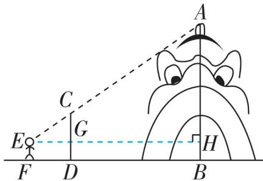

> [!success]- 必刷题
>
> > [!success] **【答案】** 详见解析
>
> > [!note]- **【解析】**
> > 【解】如图所示,过点 E 作 $EH \perp AB$ 于 H,线段 EH 与线段 CD 交于点 G,则易得 $\angle CGE =$
> >
> > $\angle AHE = 90^{\circ}$ , 四边形 $EFBH$ , 四边形 $BDGH$ , 四边形 $EFDG$ 是矩形, $\therefore BD = GH = 20 \mathrm{~m}$ , $EG = DF =$
> >
> > 
