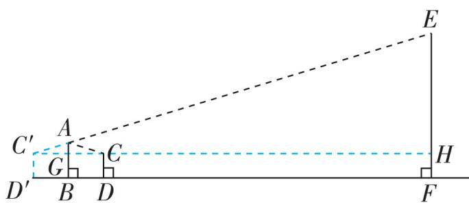
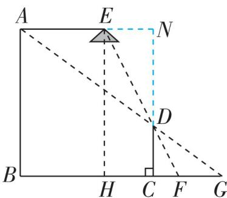
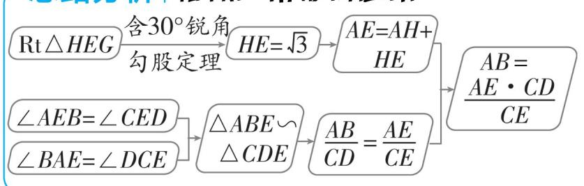

> [!success]- 必刷题
>
> > [!success] **【答案】** B
>
> > [!note]- **【解析】**
> > 在题图(2)中,延长AD交EG于点F. 由题意可得, $AF = BG = x \text{ m}, EF = EG - FG,$ $FG = AB = 1.6 \text{ m}, EG = y \text{ m}, \therefore EF = (y - 1.6) \text{ m}.$ $\because CD \perp AF, EF \perp AF, \therefore CD \parallel EF, \therefore$ 易证 $\triangle ADC \sim \triangle AFE, \therefore \frac{CD}{EF} = \frac{AD}{AF},$ 即 $\frac{0.3}{EF} = \frac{0.6}{AF},$ $\therefore \frac{0.3}{y - 1.6} = \frac{0.6}{x},$ 化简, 得 $y = \frac{1}{2}x + 1.6,$ 故选B.
> >
> > 思路分析延长 AD 交 EG 于点 F, 根据题意和图形, 可以得到 AF = BG = x m, EF = EG - FG, FG = AB = 1.6 m, EG = y m, 然后根据相似三角形的判定和性质, 可以得到 y 关于 x 的函数表达式.
> >
> > 2.7 【解析】如图, $C', D'$ 分别为点 $C, D$ 关于 $AB$ 的对称点, 过 $C'$ 作 $C'H \parallel FD$ 分别交 $AB, EF$ 于点 $G, H$ . $\because EF \parallel AB \parallel C'D'$ , $\therefore$ 易得四边形 $C'D'BG$ , 四边形 $GBFH$ 是矩形, $\therefore HF = GB = C'D' = CD = 1.5 \mathrm{~m}, C'G = D'B = BD = 2 \mathrm{~m}, GH = BF = 20 \mathrm{~m}, \therefore C'H = 22 \mathrm{~m}, AG = AB - GB = 2 - 1.5 = 0.5 (\mathrm{~m})$ . 连接 $AC'$ , 则易得 $C', A, E$ 共线. $\because \angle AC'G = \angle EC'H, \angle AGC' = \angle EHC' = 90^\circ, \therefore \triangle AC'G \sim \triangle EC'H, \therefore \frac{EH}{AG} = \frac{C'H}{C'G}, \therefore \frac{EH}{0.5} = \frac{22}{2}, \therefore EH = 5.5 \mathrm{~m}, \therefore$ 旗杆 $EF$ 的高度为 $5.5 + 1.5 = 7(\mathrm{~m})$ .
> >
> > 
> >
> > 3.5.4 【解析】如图,延长 $AE, CD$ 相交于点 $N$ .▶关键点拨
> >
> > ∵ AE∥BG, EH⊥BH,
> > ∴ 易得四边形 AEHB 是矩形, ∴ AE = BH = 3 米.
> > ∵ AE ∥ BG, ∴ 易证 $\triangle AED \sim \triangle GFD, \triangle END \sim$ 延长 AE, CD
> > 相交于点 N,
> > 构造 $\triangle AED \sim$ $\triangle GFD, \triangle END \sim$ $\triangle FCD$ 是解题的关键.
> >
> > 
> >
> > $\triangle FCD, \therefore \frac{AE}{FG} = \frac{ED}{DF} = \frac{3}{1.5} = 2, \therefore \frac{ED}{DF} = \frac{DN}{CD} = 2.$ 又 $\because CD = 1.8$ 米， $\therefore DN = 1.8 \times 2 = 3.6$ （米）， $\therefore AB = DN + CD = 3.6 + 1.8 = 5.4$ （米）．故答案为5.4.
> >
> > ## 4. 思路分析 | 相似三角形的应用
> >
> > 
> >
> > 【解】由题意得 AH = 6 米. ∵ AB ⊥ AC, GH ⊥ AC, DC ⊥ AC, ∴ ∠BAE = ∠DCE = ∠GHE = 90°. 在 Rt△GHE 中, ∠HGE = 60°, GH = 1 米, ∴ ∠HEG = 30°, ∴ GE = 2GH = 2 米, ∴ EH = $\sqrt{2^{2}-1^{2}} = \sqrt{3}$ (米), ∴ AE = AH + EH = $(6 + \sqrt{3})$ 米. ∵ ∠AEB = ∠CED, ∠BAE = ∠DCE = 90°, ∴ △ABE ∼ △CDE, ∴ $\frac{AB}{CD} = \frac{AE}{CE}$ , 即 $\frac{AB}{1.6} = \frac{6 + \sqrt{3}}{2}$ , ∴ AB = 0.8 $(6 + \sqrt{3}) \approx 6.2$ (米). 答: 建筑物的高度 AB 约为 6.2 米.
> >
> > ## 刷素养·
