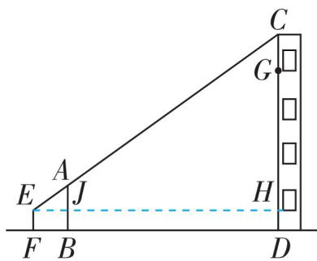
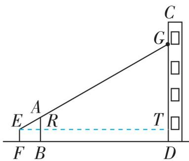

> [!success]- 必刷题
>
> > [!success] **【答案】** 详见解析
>
> > [!note]- **【解析】**
> > 【解】(1)如图(1),过点E作EH⊥CD于点H,交AB于点J,则四边形EFBJ,四边形EFDH都是矩形.∴EF = BJ = DH = 1.5米,BF = EJ = 2米,DB = JH = 23米.∵AB = 2.5米,∴AJ = AB - BJ = 2.5 - 1.5 = 1(米).∵AJ∥CH,∴易得△EAJ ∽ △ECH,∴ $\frac{AJ}{CH}=\frac{EJ}{EH}$ ,∴ $\frac{1}{CH}=\frac{2}{2+23}$ ,∴CH = 12.5米,∴CD = CH + DH = 12.5 + 1.5 = 14(米).
> >
> > 
> > 图(1)
> >
> > 
> > 图(2)
> >
> > (2)如图(2)，过点 $E$ 作 $ET \perp CD$ 于点 $T$ , 交 $AB$ 于点 $R$ . 设 $BF = x$ 米. $\because AR \parallel GT, \therefore$ 易得 $\triangle ERA \sim \triangle ETG, \therefore \frac{AR}{GT} = \frac{ER}{ET}, \therefore \frac{1}{11.5 - 1.5} = \frac{x}{2 + 23}, \therefore x = 2.5. \because 2.5 - 2 = 0.5$ （米）， $\therefore$ 标杆 $AB$ 应该向大楼方向移动 0.5 米.
> >
> > ## 7 相似三角形的性质
> >
> > ## 课时1 相似三角形中对应线段的性质
