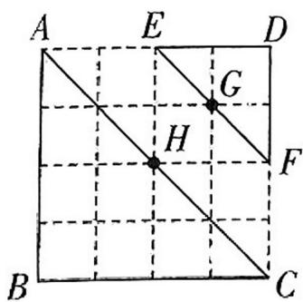
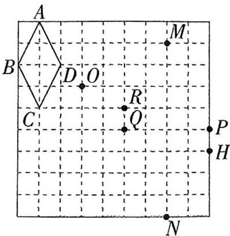

<!-- question-source:start -->
2 如图,在正方形网格中, $\triangle ABC$ 和 $\triangle DEF$ 位似,则关于位似中心与相似比叙述正确的是( )
A. 位似中心是点 B, 相似比是 2:1
B. 位似中心是点 D, 相似比是 2:1
C. 位似中心在点 G, H 之间, 相似比为 2:1
D. 位似中心在点 G, H 之间, 相似比为 1:2

(第2题图)

(第3题图)
<!-- question-source:end -->

![[Q00108088A1]]
