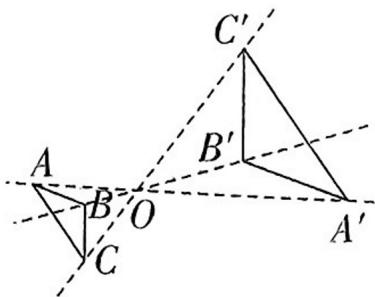

<!-- question-source:start -->
6 如图,以点 O 为位似中心,把△ABC 放大为原来的 2 倍得到 △A'B'C',以下说法正确的是\_\_\_\_。(填

① $S_{\triangle ABC}:S_{\triangle A^{\prime}B^{\prime}C^{\prime}}=1:2$ ; ②AB: $A^{\prime}B^{\prime}=1:2$ ; ③点A, O, $A^{\prime}$ 在同一条直线上; ④ $BC//B^{\prime}C^{\prime}$ .
<!-- question-source:end -->

![[Q00108092A1]]
