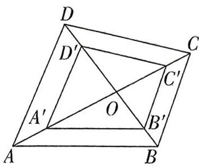
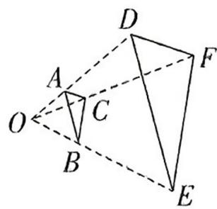

<!-- question-source:start -->
4 [2025 四川眉山质检]如图,四边形 ABCD 和 $A'B'C'D'$ 是以点 O 为位似中心的位似图形.若 $OA':A'A=2:1$ , 四边形 $A'B'C'D'$ 的面积为 $12\ cm^{2}$ , 则四边形 ABCD 的面积为 ( )
A. $24\ cm^{2}$ B. $27\ cm^{2}$ C. $36\ cm^{2}$ D. $54\ cm^{2}$

建议用时 20 分钟 答案 D66

(第 4 题图)

(第5题图)
<!-- question-source:end -->

![[Q00108284A1]]
