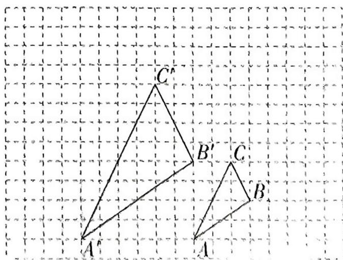

<!-- question-source:start -->
7 [2025 河南洛阳期中]如图, 在网格中, 每个小正方形的边长都是 1, $\triangle ABC$ 与 $\triangle A'B'C'$ 是以点 $O$ 为位似中心的位似图形, 它们的顶点都在小正方形的顶点上.

(1) 在网格中画出位似中心 O. (要求保留画图痕迹)

(2) $\triangle ABC$ 与 $\triangle A'B'C'$ 的相似比是 \_\_\_\_.

(3) 在网格中, 以点 $C$ 为位似中心, 画出 $\triangle A_{1}B_{1}C$ , 使它与 $\triangle ABC$ 位似, 且相似比等于 2.

<!-- question-source:end -->

![[Q00108286A1]]
