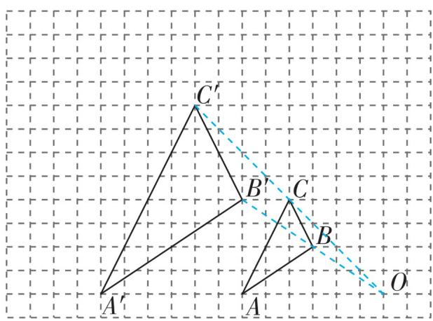
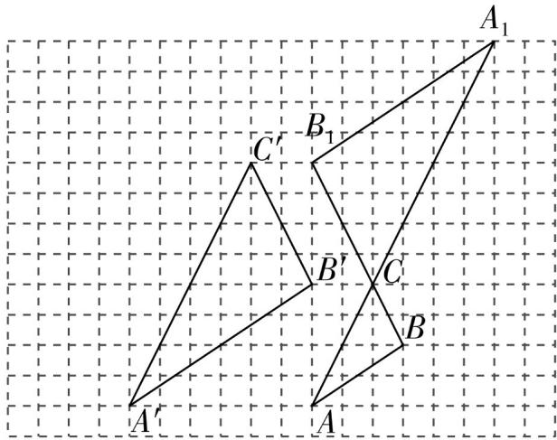

> [!success]- 必刷题
>
> > [!success] **【答案】** $\frac{1}{2}$
>
> > [!note]- **【解析】**
> > 【解】(1)如图(1)所示,点 O 即为位似中心.
> >
> > 
> > 图(1)
> >
> > 关键点拨此题分两种情况进行讨论：①连接 $HD$ 并延长交 $x$ 轴于点 $P$ ，则点 $P$ 为位似中心；
> > - **②**：连接 $CE$ ， $DF$ 交于点 $P'$ ，则点 $P'$ 为位似中心.
> >
> > (2) $\because B^{\prime}C^{\prime} = \sqrt{2^{2} + 4^{2}} = 2\sqrt{5}, BC = \sqrt{2^{2} + 1^{2}} =$ $\sqrt{5}, \therefore \frac{BC}{B^{\prime}C^{\prime}} = \frac{\sqrt{5}}{2\sqrt{5}} = \frac{1}{2}, \therefore \triangle ABC$ 与 $\triangle A'B'C'$ 的相似比是 $\frac{1}{2}$ . 故答案为 $\frac{1}{2}$ .
> >
> > (3)如图(2)所示, $\triangle A_{1}B_{1}C$ 即为所求.
> >
> > 
> > 图(2)
