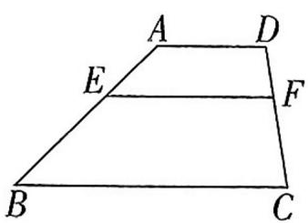
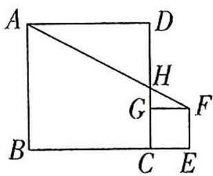

<!-- question-source:start -->
1 [2024 黑龙江哈尔滨中考] 如图, 在四边形 $ABCD$ 中, $AD \parallel BC$ , 点 $E$ 在 $AB$ 上, $EF \parallel AD$ 交 $CD$ 于点 $F$ , 若 $AE:BE = 1:2, DF = 3$ , 则 $FC$ 的长为 ( )
A.6 B.3 C.5 D.9

(第1题图)

(第2题图)

建议闲时 30 分钟 答案 D68

(1) 求证: $AD^{2}=DE \cdot DC$ ;
<!-- question-source:end -->

![[Q00108100A1]]
