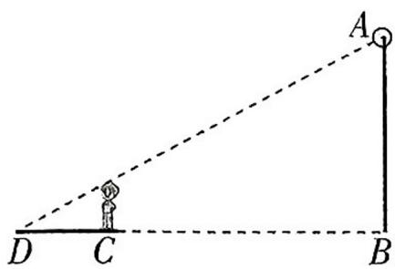
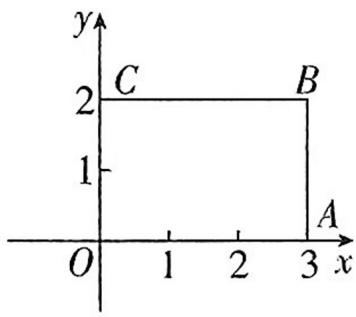

<!-- question-source:start -->
6[2024 江苏镇江中考]如图,小杰从灯杆 AB 的底部点 B 处沿水平直线前进到达点 C 处,他在灯光下的影长 CD=3 米,然后他转身按原路返回到点 B 处,返回过程中小杰在灯光下的影长可以是 ( )
A. 4. 5 米 B. 4 米 C. 3. 5 米 D. 2. 5 米

(第6题图)

(第7题图)
<!-- question-source:end -->

![[Q00108104A1]]
