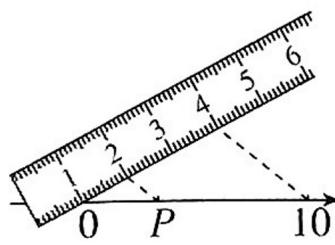
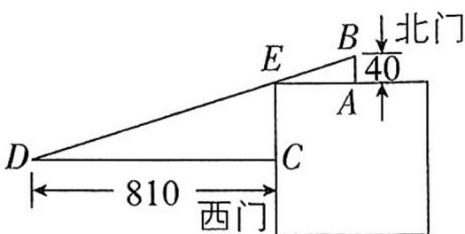

<!-- question-source:start -->
2[2025 广东汕头质检]如图是某位同学用带有刻度的直尺在数轴上作图的方法,若图中的虚线相互平行,则点 P 表示的数是 ( )
A. $\sqrt{2}$ B. 2 C. $\frac{10}{3}$ D. 5

(第2题图)

(第3题图)
<!-- question-source:end -->

![[Q00108107A1]]
