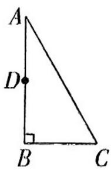
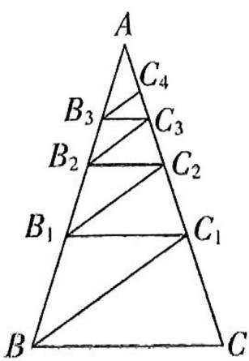

<!-- question-source:start -->
4 [2023 江苏徐州中考] 如图, 在 $\triangle ABC$ 中, $\angle B = 90^{\circ}$ , $\angle A = 30^{\circ}$ , $BC = 2$ , $D$ 为 $AB$ 的中点. 若点 $E$ 在边 $AC$ 上, 且 $\frac{AD}{AB} = \frac{DE}{BC}$ , 则 $AE$ 的长为 ( )

A. 1

B. 2

C. 1 或 $\frac{\sqrt{3}}{2}$ D. 1 或 2

(第4题图)
(第5题图)
<!-- question-source:end -->

![[Q00108109A1]]
