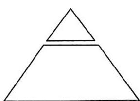
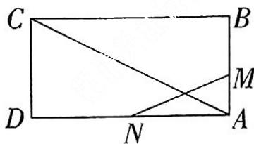

<!-- question-source:start -->
6[2025 山东临沂质检]如图, 将一张腰长为 $12 \mathrm{~cm}$ 的等腰三角形纸片, 沿与底边平行的方向剪去一张小的等腰三角形纸片, 剩下一张等腰梯形纸片. 若剪去的纸片面积是剩下的纸片面积的 $\frac{1}{8}$ , 则剪去的等腰三角形纸片的腰长为 \_\_\_\_.

(第6题图)
(第7题图)
<!-- question-source:end -->

![[Q00108111A1]]
