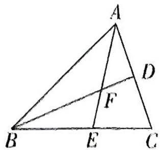
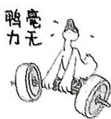

<!-- question-source:start -->
8 如图, 在 $\triangle ABC$ 中, $D$ 是 $AC$ 的中点, $\triangle ABC$ 的角平分线 $AE$ 交 $BD$ 于点 $F$ , 若 $BF:FD = 3:1$ , $AB + BE = 3\sqrt{3}$ , 则 $\triangle ABC$ 的周长为 \_\_\_\_.

<!-- question-source:end -->

![[Q00108113A1]]
