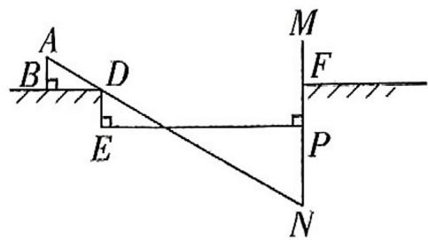

<!-- question-source:start -->
10[2025 陕西西安质检]如图,为了估算河面的宽度,即 $EP$ 的长,在离河岸 $D$ 点 2 米远的 $B$ 点,立一根长为 1 米的标杆 $AB$ ,在河对岸的岸边有一块高为 2.5 米的安全警示牌 $MF$ ,警示牌的顶端 $M$ 在河里的倒影为点 $N$ ,即 $PM = PN$ ,两岸均高出水平面 1.25 米,即 $DE = FP = 1.25$ 米,经测量此时 $A, D, N$ 三点在同一直线上,并且点 $M, F, P, N$ 共线,若 $AB, DE, MF$ 均垂直于河面 $EP$ ,求河宽 $EP$ 是多少米.

<!-- question-source:end -->

![[Q00108114A1]]
