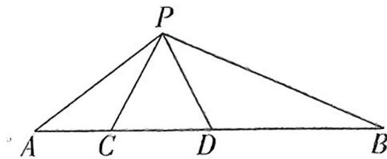

<!-- question-source:start -->
11 [2024 安徽安庆质检]如图,在 $\triangle PAB$ 中, $C,D$ 为 $AB$ 边上的两个动点, $PC=PD$ .

(1) 若 $PC=CD$ , $\angle APB=120^{\circ}$ , 则 $\triangle APC$ 与 $\triangle PBD$ 相似吗? 为什么?

(2) 当 $\angle CPD$ 和 $\angle APB$ 满足怎样的数量关系时, $\triangle APC\sim\triangle PBD$ ? 请说明理由.

<!-- question-source:end -->

![[Q00108115A1]]
