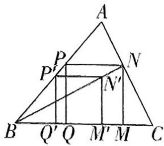

<!-- question-source:start -->
12 如图, 在 $\triangle ABC$ 中, $P'$ 是边 $AB$ 上一点, 四边形 $P'Q'M'N'$ 是正方形, 点 $Q', M'$ 在边 $BC$ 上, 点 $N'$ 在 $\triangle ABC$ 内. 连接 $BN'$ 并延长交 $AC$ 于点 $N$ , 过点 $N$ 作 $NM \perp BC$ 于点 $M, NP \perp MN$ 交 $AB$ 于点 $P$ , 过点 $P$ 作 $PQ \perp BC$ 于点 $Q$ . (1) 求证: 四边形 $PQMN$ 为正方形. (2) 若 $\angle A = 90^\circ$ , $AC = 1.5$ , $\triangle ABC$ 的面积为 1.5, 求 $PN$ 的长. (3) 有一块锐角三角形余料, 要把它加工成一个正方形零件, 使得正方形的一边在三角形的一边上, 正方形的另外两个顶点分别在三角形的其他两边上. 若三角形的三边长分别是 $50 \mathrm{~cm}, 50 \mathrm{~cm}, 60 \mathrm{~cm}$ , 则这个正方形零件的边长最大是 \_\_\_\_ cm.

<!-- question-source:end -->

![[Q00108116A1]]
