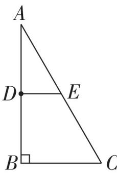
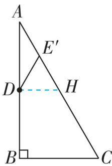

> [!success]- 必刷题
>
> > [!success] **【答案】** D
>
> > [!note]- **【解析】**
> > 在 $\triangle ABC$ 中, $\angle B = 90^{\circ}$ , $\angle A = 30^{\circ}$ , $BC = 2$ , $\therefore AC = 2BC = 4$ , $\angle C = 60^{\circ}$ , $\therefore$ 由勾股定理得 $AB = 2\sqrt{3}$ . $\because$ 点 $D$ 是 $AB$ 的中点, $\therefore AD = \sqrt{3}$ . 如图(1), 当 $\angle ADE = 90^{\circ}$ 时, $\because \angle ADE =$
> >
> > 
> > 图(1)
> >
> > $\angle ABC, \frac{AD}{AB} = \frac{DE}{BC}, \therefore \triangle ADE \sim \triangle ABC, \therefore \frac{AE}{AC} = \frac{AD}{AB} = \frac{1}{2}, \therefore AE = 2.$
> >
> > 如图(2)，当 $\angle ADE' \neq 90^\circ$ 时，取 $AC$ 的中点 $H$ ，连接 $DH$ . $\because$ 点 $D$ 是 $AB$ 中点，点 $H$ 是 $AC$ 的中点， $\therefore DH \parallel BC, DH = \frac{1}{2} BC = 1,$ $\therefore \angle AHD = \angle C = 60^\circ, DH =$
> >
> > 
> > 图(2)
> >
> > $DE^{\prime} = 1, \therefore \angle DE^{\prime}H = 60^{\circ}, \therefore \angle ADE^{\prime} = \angle A = 30^{\circ}, \therefore AE^{\prime} = DE^{\prime} = 1.$ 故选D.
> >
> > 关键点拨根据题意,利用相似三角形的判定与性质分别求出 $C_{1}C_{2},C_{2}C_{3},\cdots$ 的长,即可得出规律,从而得到答案.
