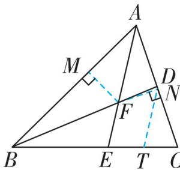
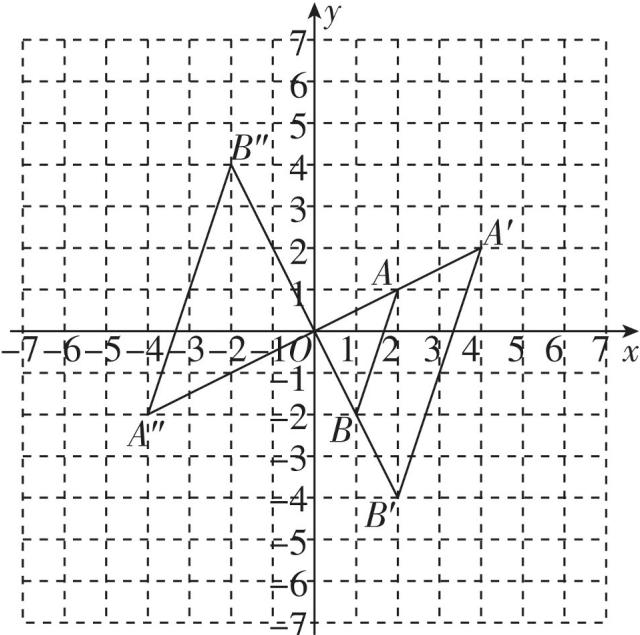

> [!success]- 必刷题
>
> > [!success] **【答案】** $5\sqrt{3}$
>
> > [!note]- **【解析】**
> > 如图, 过点 F 作 $FM \perp AB$ 于点 M, $FN \perp AC$ 于点 N, 过点 D 作 $DT \parallel AE$ 交 BC 于点 T. ∵ AE 平分 $\angle BAC, FM \perp AB, FN \perp$
> >
> > 
> >
> > $AC, \therefore FM = FN, \therefore \frac{S_{\triangle ABF}}{S_{\triangle ADF}} = \frac{BF}{DF} = \frac{\frac{1}{2} \cdot AB \cdot FM}{\frac{1}{2} \cdot AD \cdot FN} = 3, \therefore AB = 3AD.$ 设 $AD = DC = a$ ，则 $AB = 3a.$ $\because AD = DC, DT // AE, \therefore ET = CT, \frac{BE}{ET} = \frac{BF}{DF} = 3.$ 设 $ET = CT = b$ ，则 $BE = 3b. \because AB + BE = 3\sqrt{3}, \therefore 3a + 3b = 3\sqrt{3}, \therefore a + b = \sqrt{3}, \therefore \triangle ABC$ 的周长为 $AB + AC + BC = 5a + 5b = 5\sqrt{3}$ ，故答案为 $5\sqrt{3}$ .
> >
> > 【解】(1)如图， $\triangle OA'B'$ ， $\triangle OA''B''$ 即为所求.
> >
> > 
> >
> > (2) 若对应点在 $\triangle OA'B'$ 中, 对应点坐标为 $(2a, 2b)$ ; 若对应点在 $\triangle OA''B''$ 中, 对应点坐标为 $(-2a, -2b)$ . 故对应点坐标为 $(2a, 2b)$ 或 $(-2a, -2b)$ .
> >
> > 思路分析
> > (1) 由条件可得 $\angle PCD = \angle PDC = \angle CPD = 60^{\circ}$ , 从而得到 $\angle ACP = \angle BDP = 120^{\circ}$ , 结合 $\angle APB = 120^{\circ}$ 可得到 $\angle A = \angle BPD$ , 即可证明 $\triangle APC \sim \triangle PBD$ .
> >
> > > 思路分析
> > 过点 F 作 $FM \perp AB$ 于点 M, $FN \perp AC$ 于点 N, 过点 D 作 $DT \parallel AE$ 交 BC 于点 T. 证明 AB = 3AD, 设 AD = CD = a, 则 AB = 3a; 证明 ET = CT, 设 ET = CT = b, 则 BE = 3b, 根据 $AB + BE = 3\sqrt{3}$ 求出 $a + b$ 的值, 进而可得出答案.
