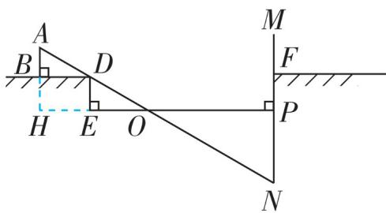

> [!success]- 必刷题
>
> > [!success] **【答案】** 详见解析
>
> > [!note]- **【解析】**
> > 【解】如图,设 AN 与 EP 交于点 O,延长 AB 交 PE 的延长线于点 H,则易得四边形 BDEH 是矩形,∴ BH=DE=1.25,BD//EH,
> >
> > 
> >
> > $\therefore AH = AB + BH = 2.25.\because BD \parallel OH, \therefore$ 易得 $\triangle ABD \sim \triangle AHO, \therefore \frac{BD}{HO} = \frac{AB}{AH}$ , 即 $\frac{2}{HO} = \frac{1}{2.25}$ , 解得 $HO = 4.5.\because PM = PN, MF = 2.5, FP = 1.25, \therefore PN = MF + FP = 3.75.\because \angle AHO = 90^{\circ} = \angle NPO, \angle AOH = \angle NOP, \therefore \triangle AHO \sim \triangle NPO, \therefore \frac{AH}{PN} = \frac{OH}{OP}$ , 即 $\frac{2.25}{3.75} = \frac{4.5}{OP}$ , 解得 $OP =$
