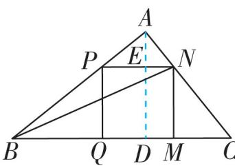
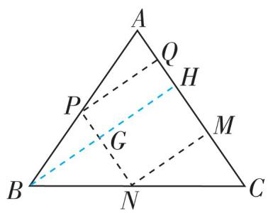
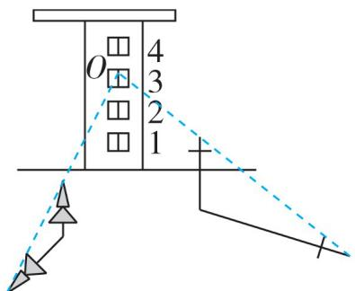
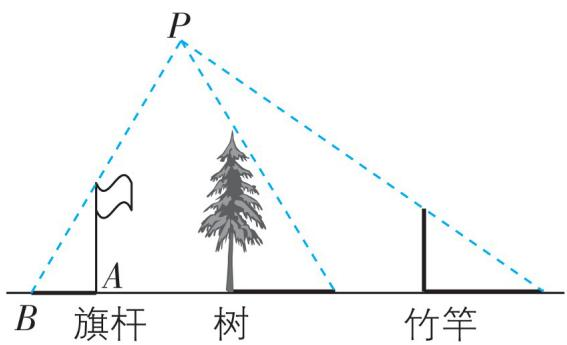
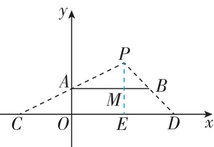
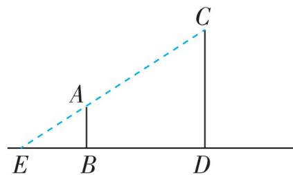
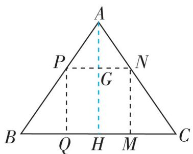

> [!success]- 必刷题
>
> > [!success] **【答案】** A
>
> > [!note]- **【解析】**
> > 【证明】∵ $NM \perp BC, NP \perp MN, PQ \perp BC,$ ∴ 四边形 PQMN 为矩形. ∵ 四边形 $P'Q'M'N'$ 是正方形, ∴ $PN \parallel P'N', MN \parallel M'N',$ ∴ 易得 $\triangle BN'P'\sim\triangle BNP,\triangle BM'N'\sim\triangle BMN,$ ∴ $\frac{P'N'}{PN} = \frac{BN'}{BN}, \frac{M'N'}{MN} = \frac{BN'}{BN},$ ∴ $\frac{P'N'}{PN} = \frac{M'N'}{MN}.$ ∵ $P'N' = M'N', \therefore PN = MN, \therefore$ 四边形 PQMN 为正方形.
> >
> > 【解】(2) 过点 $A$ 作 $AD \perp BC$ , 垂足为 $D$ , 交 $PN$ 于点 $E$ , 如图 (1) (简略图). $\because \triangle ABC$ 的面积为 1.5, $AC = 1.5$ ,
> >
> > 
> > 图(1)
> >
> > $\angle BAC = 90^{\circ}, \therefore \frac{1}{2} AB \cdot AC = 1.5, \therefore AB = 2,$ $\therefore BC = \sqrt{2^{2} + 1.5^{2}} = 2.5. \because \frac{1}{2} BC \cdot AD = 1.5,$ $\therefore AD = \frac{2 \times 1.5}{2.5} = \frac{6}{5}$ . 设 $PN = x$ , 则 $PQ = DE = x$ $AE = \frac{6}{5} - x.$ $\because PN // BC, \therefore$ 易得 $\triangle APN \sim$ $\triangle ABC, \therefore \frac{AE}{AD} = \frac{PN}{BC}$ , 即 $\frac{\frac{6}{5} - x}{\frac{6}{5}} = \frac{x}{2.5}$ , 解得 $x = \frac{30}{37}$ ,
> > 即 $PN$ 的长为 $\frac{30}{37}$ .
> > (3) 假设锐角三角形余料为 $\triangle ABC$ , 其中 $AB = AC = 50~\mathrm{cm}, BC = 60~\mathrm{cm}$ , 正方形零件为 $PQMN$ . 当正方形一边 $QM$ 在底边 $BC$ 上时，如图(2), 作 $AH \perp BC$ 于 $H$ , 交 $PN$ 于 $G$ , 则 $BH = CH = 30 \mathrm{~cm}$ , 由勾股定理得 $AH = 40 \mathrm{~cm}$ . 设正方形边长为 $x \mathrm{~cm}$ . $\because PN \parallel BC, \therefore$ 易得 $\triangle APN \sim \triangle ABC, \therefore \frac{AG}{AH} = \frac{PN}{BC}, \therefore \frac{40 - x}{40} = \frac{x}{60}$ , 解得 $x = 24$ .
> >
> > 
> > 图(2)
> >
> > 
> > 图(3)
> >
> > 思路分析
> > (3) 分正方形一边在底边和腰上两种情形, 分别画图, 利用相似三角形的高之比等于相似比, 求出正方形边长, 通过比较即可得出最大边长.
> >
> > 当 $QM$ 在腰上时, 如图(3), 作 $BH \perp AC$ 于 $H$ , 交 $PN$ 于 $G$ . 由等面积法可得 $BH = \frac{40 \times 60}{50} = 48(\text{cm})$ . 设正方形边长为 $x \text{ cm}$ . $\because PN // AC$ , $\therefore$ 易得 $\triangle BPN \sim \triangle BAC$ , $\therefore \frac{PN}{AC} = \frac{BG}{BH}$ , $\therefore \frac{x}{50} = \frac{48 - x}{48}$ , 解得 $x = \frac{1200}{49}$ . $\because \frac{1200}{49} > 24$ , $\therefore$ 这个正方形零件的边长最大为 $\frac{1200}{49} \text{ cm}$ , 故答案为 $\frac{1200}{49}$ .
> >
> > ## 第五章 投影与视图
> >
> > ## 1 投影
> >
> > ## 课时 1 中心投影
> >
> > ## 刷基础
> >
> > 1. A 【解析】灯光下猫咪映在墙上的影子是投影,A 选项符合题意;小明看到镜子里的自己不是投影,B 选项不符合题意;自行车行驶过后车轮留下的痕迹不是投影,C 选项不符合题意;掉在地上的树叶不是投影,D 选项不符合题意.故选 A.
> >
> > 2. A 【解析】从一个点发出的光线所形成的投影叫做中心投影,所以晚上在房间内墙上的手影、都市霓虹灯形成的影子、舞台上演员的影子都是中心投影,而月光下房屋的影子不是中心投影.故选 A.
> >
> > 3. 3 【解析】如图, 点 O 即为点光源, ∴ 亮着灯的窗口是 3 号窗口. 故答案为 3.
> >
> > 
> >
> > 4.【解】P 点位置及旗杆的影子 AB 如图所示.
> >
> > 
> >
> > 5. B 【解析】晚上小亮在路灯下散步, 在小亮由 A 处径直走到 B 处这一过程中, 他在地上的影子先变短后变长. 故选 B.
> >
> > 影子的顶端和物体的顶端的连线即为一条光线，多条光线的交点即为光源的位置.
> >
> > 6.6 【解析】过 $P$ 作 $PE \perp x$ 轴于 $E$ , 交 $AB$ 于 $M$ , 如图. $\because P(2,2), A(0,1), B(3,1), \therefore PM = 1,$
> >
> > 
> >
> > $PE = 2, AB = 3.\because AB \parallel CD, \therefore \triangle PAB \sim \triangle PCD,$ $\therefore \frac{AB}{CD} = \frac{PM}{PE}$ , 即 $\frac{3}{CD} = \frac{1}{2}, \therefore CD = 6$ , 故答案为 6.
> >
> > 7.2 【解析】根据题意得 $CE \perp CF, CD = 4, FD = 8$ . $\because CE \perp CF, \therefore \angle ECF = 90^{\circ}, \therefore \angle ECD + \angle DCF = 90^{\circ}$ . $\because CD \perp EF, \therefore \angle CDE = \angle CDF = 90^{\circ}, \therefore \angle F + \angle DCF = 90^{\circ}, \therefore \angle ECD = \angle CFD,$ $\therefore Rt\triangle CDE \sim Rt\triangle FDC, \therefore \frac{ED}{CD} = \frac{CD}{FD}$ , 即 $CD^{2} = ED \cdot FD$ , 代入数据可得 $4^{2} = 8ED$ , 解得 $ED = 2$ , 即 $B$ 时的影长 $DE$ 为 $2\mathrm{m}$ . 故答案为 2.
> >
> > 8.【解】(1) 小光在路灯 $C$ 下的影子 $BE$ 如图所示.
> >
> > 
> >
> > 知, $AB \parallel CD$ , ∴ 易得 $\triangle EAB \sim \triangle ECD$ , ∴ $\frac{AB}{CD} = \frac{BE}{DE}$ , ∴ $\frac{1.8}{CD} = \frac{3}{3+5}$ , ∴ CD = 4.8 m.
> > 答:灯杆 CD 的高度为 4.8 m.
> >
> > ## 刷提升
> >
> > 1. D 【解析】小明和小颖在同一盏路灯下的影子方向相反,且他们影子的顶端分别与他们各自的头顶以及路灯顶端在同一条直线上.故选 D.
> >
> > 2. D 【解析】因为小阳和小明两人从远处沿直线走到路灯下这一过程中离光源越来越近，如图(2), 作 $AH \perp BC$ 于 $H$ , 交 $PN$ 于 $G$ , 则 $BH = CH = 30 \mathrm{~cm}$ , 由勾股定理得 $AH = 40 \mathrm{~cm}$ . 设正方形边长为 $x \mathrm{~cm}$ . $\because PN \parallel BC, \therefore$ 易得 $\triangle APN \sim \triangle ABC, \therefore \frac{AG}{AH} = \frac{PN}{BC}, \therefore \frac{40 - x}{40} = \frac{x}{60}$ , 解得 $x = 24$ .
> >
> > 
> > 图(2)
> >
> > 
> > 图(3)
> >
> > 思路分析
> > (3) 分正方形一边在底边和腰上两种情形, 分别画图, 利用相似三角形的高之比等于相似比, 求出正方形边长, 通过比较即可得出最大边长.
> >
> > 当 $QM$ 在腰上时, 如图(3), 作 $BH \perp AC$ 于 $H$ , 交 $PN$ 于 $G$ . 由等面积法可得 $BH = \frac{40 \times 60}{50} = 48(\text{cm})$ . 设正方形边长为 $x \text{ cm}$ . $\because PN // AC$ , $\therefore$ 易得 $\triangle BPN \sim \triangle BAC$ , $\therefore \frac{PN}{AC} = \frac{BG}{BH}$ , $\therefore \frac{x}{50} = \frac{48 - x}{48}$ , 解得 $x = \frac{1200}{49}$ . $\because \frac{1200}{49} > 24$ , $\therefore$ 这个正方形零件的边长最大为 $\frac{1200}{49} \text{ cm}$ , 故答案为 $\frac{1200}{49}$ .
> >
> > ## 第五章 投影与视图
> >
> > ## 1 投影
