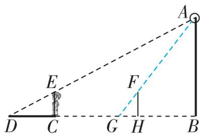

> [!success]- 必刷题
>
> > [!success] **【答案】** D
>
> > [!note]- **【解析】**
> > 如图,设返回过程中小杰身高为FH,连接AF并延长交BD于G.由FH//AB//EC,易得△FGH ∽
> >
> > 
> >
> > $\triangle AGB, \triangle EDC \sim \triangle ADB, \therefore$ 易得 $\frac{GH}{GB} = \frac{FH}{AB} = \frac{EC}{AB} = \frac{DC}{DB}$ . 由 $GB < DB$ , 得 $GH < DC = 3$ 米.
> >
> > 故选 **D**.
