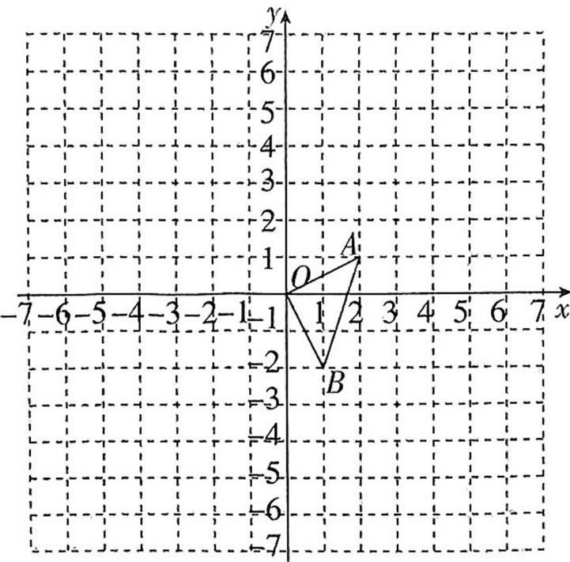

## 全章综合训练 刷章测

![[初中/课堂同步/教辅/必刷题/2026《初中必刷题》数学北师9上/04_第四章_图形的相似/全章综合训练/questions/Q00108106.md]]
![[初中/课堂同步/教辅/必刷题/2026《初中必刷题》数学北师9上/04_第四章_图形的相似/全章综合训练/questions/Q00108107.md]]
![[初中/课堂同步/教辅/必刷题/2026《初中必刷题》数学北师9上/04_第四章_图形的相似/全章综合训练/questions/Q00108108.md]]
![[初中/课堂同步/教辅/必刷题/2026《初中必刷题》数学北师9上/04_第四章_图形的相似/全章综合训练/questions/Q00108109.md]]
![[初中/课堂同步/教辅/必刷题/2026《初中必刷题》数学北师9上/04_第四章_图形的相似/全章综合训练/questions/Q00108110.md]]

## 二、填空题(本大题共3小题,每小题6分,共18分)

![[初中/课堂同步/教辅/必刷题/2026《初中必刷题》数学北师9上/04_第四章_图形的相似/全章综合训练/questions/Q00108111.md]]
![[初中/课堂同步/教辅/必刷题/2026《初中必刷题》数学北师9上/04_第四章_图形的相似/全章综合训练/questions/Q00108112.md]]
![[初中/课堂同步/教辅/必刷题/2026《初中必刷题》数学北师9上/04_第四章_图形的相似/全章综合训练/questions/Q00108113.md]]

## 三、解答题(本大题共4小题,共57分)

如图, 在平面直角坐标系中, $\triangle OAB$ 的顶点坐标分别为 $O(0,0), A(2,1), B(1,-2)$ . (1) 以原点 $O$ 为位似中心, 画三角形, 使它与 $\triangle OAB$ 位似, 且相似比为 $2:1$ ; (2) $\triangle AOB$ 内部一点 $M$ 的坐标为 $(a,b)$ , 写出点 $M$ 在 (1) 中 $\triangle AOB$ 的位似图形中对应点的坐标.

![[初中/课堂同步/教辅/必刷题/2026《初中必刷题》数学北师9上/04_第四章_图形的相似/全章综合训练/questions/Q00108114.md]]
![[初中/课堂同步/教辅/必刷题/2026《初中必刷题》数学北师9上/04_第四章_图形的相似/全章综合训练/questions/Q00108115.md]]
![[初中/课堂同步/教辅/必刷题/2026《初中必刷题》数学北师9上/04_第四章_图形的相似/全章综合训练/questions/Q00108116.md]]
