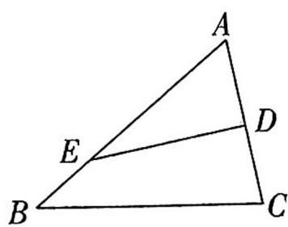
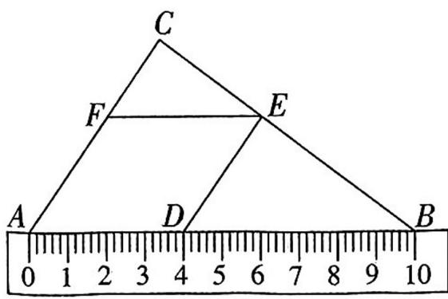

<!-- question-source:start -->
1 [2024 北京昌平区期中, 中] 如图, 在 $\triangle ABC$ 中, $AB = 6$ , $CA = 4$ , 点 $D$ 为 $AC$ 中点, 点 $E$ 在 $AB$ 上, 当 $AE$ 为 \_\_\_\_ 时, $\triangle ABC$ 与以点 $A, D, E$ 为顶点的三角形相似.

(第1题图)

(第2题图)
<!-- question-source:end -->

![[Q00108032A1]]
