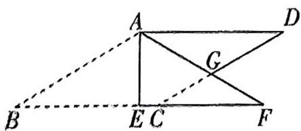
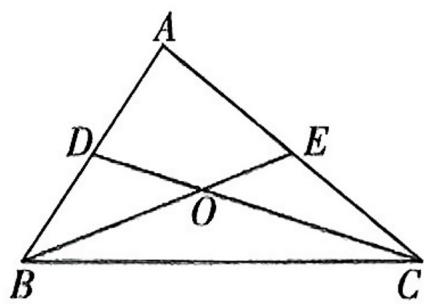

<!-- question-source:start -->
3[2024 重庆沙坪坝区调研, 中]如图, 在边长为 $\sqrt{3}$ 的菱形 $ABCD$ 中, $\angle B = 30^{\circ}$ , 过点 $A$ 作 $AE \perp BC$ 于点 $E$ , 现将 $\triangle ABE$ 沿直线 $AE$ 翻折至 $\triangle AFE$ 的位置, $AF$ 与 $CD$ 交于点 $G$ , 则 $CG$ 等于 \_\_\_\_.

(第3题图)

(第4题图)
<!-- question-source:end -->

![[Q00108034A1]]
