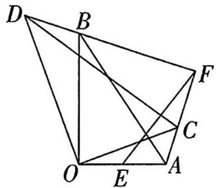
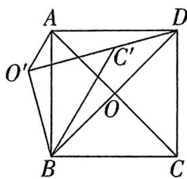

<!-- question-source:start -->
5[2024 四川成都双流区质检,较难]如图,在 Rt△AOB 和 Rt△COD 中,∠AOB = ∠COD = 90°,∠ABO = ∠CDO,E 为 OA 的中点,OA = 4, OB = 6. 将△COD 绕点 O 旋转,直线 AC,BD 交于点 F,连接 EF,则 EF 的最小值是 \_\_\_\_.

(第 5 题图)
(第6题图)
<!-- question-source:end -->

![[Q00108036A1]]
