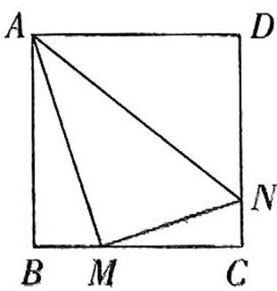

<!-- question-source:start -->
7[中]如图,正方形ABCD边长为4,M,N分别是BC,CD上的两个动点,当M点在BC上运动时,保持AM和MN垂直,设BM=x.

(1) 求证: Rt△ABM∼Rt△MCN;

(2) 当 $M$ 点运动到什么位置时 $\mathrm{Rt} \triangle ABM \sim \mathrm{Rt} \triangle AMN$ ? 求此时 $x$ 的值.

<!-- question-source:end -->

![[Q00108038A1]]
