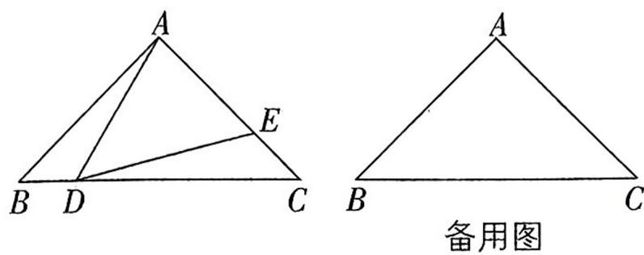

<!-- question-source:start -->
8[较难]如图,在 $\triangle ABC$ 中,点 $D,E$ 分别在边 $BC,AC$ 上,连接 $AD,DE$ ,且 $\angle B=\angle ADE=\angle C$ .

(1)求证: $\triangle BDA\sim\triangle CED$ ;

(2)若 $\angle B=45^{\circ},BC=2$ ,当点 $D$ 在 $BC$ 上运动(点 $D$ 不与 $B,C$ 重合),且 $\triangle ADE$ 是等腰三角形时,求 $BD$ 的长.

<!-- question-source:end -->

![[Q00108039A1]]
