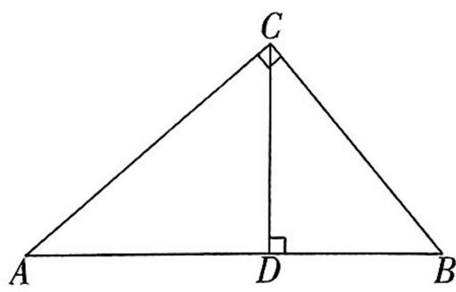

<!-- question-source:start -->
9[中]如图,在 $\triangle ABC$ 中, $\angle ACB=90^{\circ}$ , $CD$ 是斜边 $AB$ 上的高. (1)求证: $\triangle ACD \sim \triangle CBD$ ; (2)求证: $BC^{2}=BD \cdot AB$ ; (3)若 $AD=3, BD=2$ ,求 $CD$ 的长.

<!-- question-source:end -->

![[Q00108040A1]]
