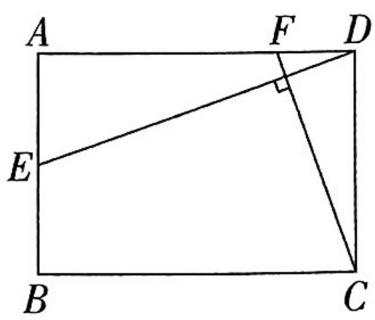
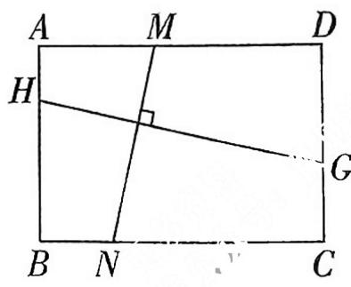
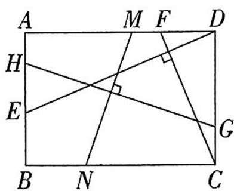
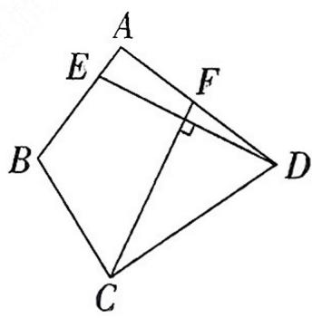

<!-- question-source:start -->
10[2025 河北保定期中,较难]某班数学课题学习小组对矩形内两条互相垂直的线段与矩形两邻边的数量关系进行探究,下面是他们的探究过程,请你按要求完成相应的证明和计算.

【初步发现】(1)如图(1),在矩形ABCD中,如果DE交AB于点E,CF交AD于点F,且 $DE\perp CF$ ,那么 $\frac{DE}{CF}$ —— $\frac{AD}{CD}$ (填“>”“<”或“=”);【深入探究】(2)如图(2),在矩形ABCD中,MN⊥GH,MN分别交AD,BC于点M,N,GH分别交AB,CD于点H,G,求证: $\frac{GH}{MN}=\frac{AD}{CD}$ ;【尝试应用】(3)在(1)的条件下,如图(3),在矩形ABCD中,点H,G分别在边AB,DC上,点M,N分别在边AD,BC上,连接MN,GH,且 $MN\perp GH$ ,若 $\frac{GH}{MN}=\frac{7}{5}$ ,求 $\frac{DE}{CF}$ 的值;【联系拓展】(4)如图(4),在四边形ABCD中,若AB=BC=6,AD=CD=8, $\angle BAD=90^{\circ}$ , $DE\perp CF$ ,直接写出 $\frac{DE}{CF}$ 的值.

图(1)

图(3)

图(2)

图(4)

电子错题本鸭
<!-- question-source:end -->

![[Q00108041A1]]
