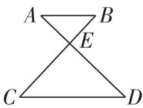
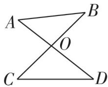

> [!success]- 必刷题
>
> > [!success] **【答案】** A
>
> > [!note]- **【解析】**
> > 由题意得 $AD = 4, BD = 6, AB = 10$ . $\because DE \parallel AC, EF \parallel AB, \therefore$ 四边形 $ADEF$ 为平行四边形, $\therefore AF = DE, EF = AD = 4$ . $\because EF \parallel AD, \therefore$ 易得 $\triangle CEF \sim \triangle CBA, \therefore \frac{CF}{CA} = \frac{EF}{AB}, \therefore \frac{CF}{6} = \frac{4}{10}$ , $\therefore CF = 2.4, \therefore AF = AC - CF = 6 - 2.4 = 3.6, \therefore DE = 3.6$ . 故 A 选项符合题意. 故选 A.
> >
> > ## 大招解读 | 8 字型
> >
> > <table><tr><td>正8字型</td><td>斜8字型(蝴蝶型)</td></tr><tr><td> 已知:AB//CD; 结论: △ABE ∼ △DCE</td><td> 已知:∠B=∠D; 结论:△AOB∼△COD</td></tr></table>
