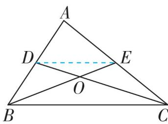
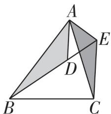
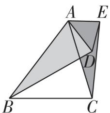
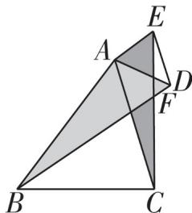

> [!success]- 必刷题
>
> > [!success] **【答案】** $\frac{\sqrt{3}}{2}$
>
> > [!note]- **【解析】**
> > 如图所示, 连接 $DE$ . $\because$ 点 $D, E$ 分
> >
> > 别是 $AB, AC$ 的中点， $\therefore DE$ 为 $\triangle ABC$ 的中位线， $\therefore DE \parallel BC, DE = \frac{1}{2} BC, \therefore$ 易得 $\triangle DOE \sim$
> >
> > 
> >
> > $\triangle COB, \therefore \frac{DO}{OC} = \frac{DE}{BC} = \frac{1}{2}$ . 设 $DO = k$ , 则 $OC = 2k$ , $\therefore CD = 3k$ . $\because DE \parallel BC, \therefore \angle EBC = \angle DEB$ . 又$\because \angle ACO = \angle EBC, \therefore \angle DEB = \angle ACO.$ 又 $\because \angle EDO = \angle CDE, \therefore \triangle DEO \sim \triangle DCE,$ $\therefore \frac{DE}{DC} = \frac{DO}{DE}, \therefore DE^2 = DC \cdot DO$ ，即 $DE^2 = 3k \times k = 3k^2, \therefore DE = \sqrt{3}k, \therefore BC = 2\sqrt{3}k, \therefore \frac{CD}{BC} = \frac{3k}{2\sqrt{3}k} = \frac{\sqrt{3}}{2}$ . 故答案为 $\frac{\sqrt{3}}{2}$ .
> >
> > 大招解读 | 手拉手型
> > △ABD 和 △ACE 共顶点 A, 通过两边成比例且夹角相等或利用旋转构造等角来判定三角形相似. 常见模型如下:
> >
> > 
> >
> > 
> >
> > 
> >
> > AD 在 $\triangle ABC$ AD 在 $\triangle ABC$ AD 在 $\triangle ABC$ 内且拉手线 外且拉手线 外且拉手线 CE 和 BD 无 CE 和 BD 无 CE 和 BD 有交点 交点 交点
> >
> > ## 思路分析
