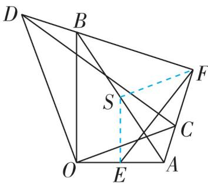

> [!success]- 必刷题
>
> > [!success] **【答案】** $\sqrt{13} -3
>
> > [!note]- **【解析】**
> > 如图，取 $AB$ 的中点 $S$ , 连接 $ES, FS$ , 则 $FS - ES \leqslant FE \leqslant ES + FS$ . $\because \angle AOB = 90^{\circ}, OA = 4, OB = 6,$
> >
> > 
> >
> > 取 $AB$ 的中点 $S$ ，连接 $ES,$ $FS$ ，则 $FS - ES\leqslant EF\leqslant FS + ES.$ 由题意可知， $\triangle AOB\sim$ △COD，进而可得△DOB∽△COA，所以∠OBD =
> >
> > $\angle OAC$ ，根据四边形内角和可得 $\angle AOB = \angle AFB = 90^{\circ}$ 再根据直角三角形斜边上的中线等于斜边的一半可得出FS的长，根据中位线定理可得ES的长，由此可得结论.
> >
> > $\therefore AB = 2\sqrt{13}.\because \angle AOB = \angle COD = 90^{\circ},$ $\angle ABO = \angle CDO,\therefore \triangle AOB\sim \triangle COD,\therefore OB:$ $OD = OA:OC.\because \angle AOB = \angle COD,\therefore \angle AOC =$ $\angle BOD,\therefore \triangle DOB\sim \triangle COA,\therefore \angle OBD =$ $\angle OAC.\because \angle OBD + \angle FBO = 180^{\circ},\therefore \angle OAC+$ $\angle FBO = 180^{\circ},\therefore \angle AOB + \angle AFB = 180^{\circ},$ $\therefore \angle AFB = \angle AOB = 90^{\circ}.$ 又 $\because S$ 为 $AB$ 的中点， $\therefore FS = \frac{1}{2} AB = \sqrt{13}.\because E$ 为 $OA$ 的中点， $S$ 为 $AB$ 的中点， $\therefore ES = \frac{1}{2} OB = 3,\therefore EF$ 的最小值为 $\sqrt{13} -3.$ 故答案为 $\sqrt{13} -3.$
