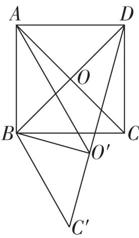
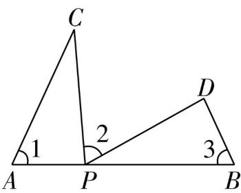
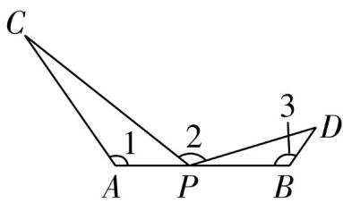
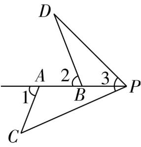
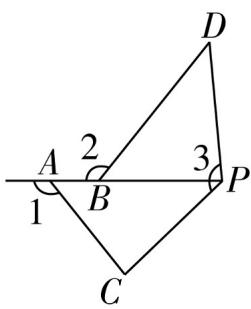

> [!success]- 必刷题
>
> > [!success] **【答案】** $\sqrt{3}-1$ 或 $\sqrt{3}+1$
>
> > [!note]- **【解析】**
> > - **①**：当 $O'C'$ 在 $BD$ 的上方时, $\because \triangle O'C'B$ , $\triangle ABD$ 是等腰直角三角形, $\therefore O'B:BC'=AB:BD=1:\sqrt{2}$ . $\because \angle ABO'+\angle ABC'=\angle DBC'+\angle ABC'=45^\circ$ , $\therefore \angle ABO'=\angle DBC',\therefore \triangle ABO'\sim\triangle DBC',\therefore AO':DC'=AB:$ $BD.\because BC'=BC=2,\therefore O'C'=BO'=\frac{\sqrt{2}}{2}BC'=\sqrt{2}$ ,
> >
> > $BD = \sqrt{2} BC = 2\sqrt{2}. \because DO'^{2} = BD^{2} - BO'^{2},$ $\therefore DO'^{2}=(2\sqrt{2})^{2}-(\sqrt{2})^{2},\therefore DO'=\sqrt{6},$ $\therefore DC'=\sqrt{6}-\sqrt{2},\therefore AO':(\sqrt{6}-\sqrt{2})=1:\sqrt{2},$ $\therefore AO'=\sqrt{3}-1.$
> > - **②**：当 $O^{\prime}C^{\prime}$ 在 BD 的下方时, 如图所示. 同理可证 $\triangle ABO^{\prime} \sim \triangle DBC^{\prime}, \therefore AO^{\prime}: DC^{\prime} = AB:$ $BD = 1 : \sqrt{2}. \because BC' = BC = 2,$ $\therefore O^{\prime}C^{\prime}=BO^{\prime}=\frac{\sqrt{2}}{2}BC^{\prime}=\sqrt{2},$ $BD=\sqrt{2}BC=2\sqrt{2}.\because DO^{2}=$
> >
> > 
> >
> > $BD^{2}-BO'^{2},\therefore DO'^{2}=(2\sqrt{2})^{2}-(\sqrt{2})^{2},\therefore DO'=\sqrt{6},\therefore DC'=\sqrt{6}+\sqrt{2},\therefore AO':(\sqrt{6}+\sqrt{2})=1:\sqrt{2},\therefore AO'=\sqrt{3}+1.$ 综上所述， $AO'$ 的长为 $\sqrt{3}-1$ 或 $\sqrt{3}+1.$
> >
> > 大招解读 | 一线三等角型
> > 如图, 已知 A, P, B 三点共线, 且 $\angle 1 = \angle 2 = \angle 3$ .
> > (1) 点 P 在线段 AB 上:
> >
> > 
> >
> > 
> > 图(1)
> > 图(2)
> >
> > (2) 点 $P$ 在线段 $AB$ 的延长线上:
> >
> > 
> >
> > 
> > 图(3)
> > 图(4)
> >
> > 结论: $\triangle ACP \sim \triangle BPD.$
