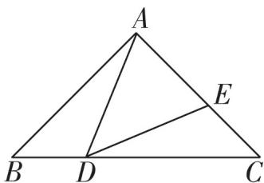
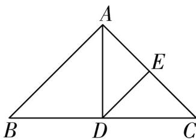
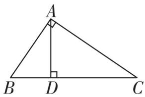

> [!success]- 必刷题
>
> > [!success] **【答案】** AD
>
> > [!note]- **【解析】**
> > 【证明】由题图, 得 $\angle ADE + \angle ADB + \angle EDC = 180^{\circ}$ . 在 $\triangle ABD$ 中, $\because \angle B + \angle ADB + \angle DAB = 180^{\circ}, \angle B = \angle ADE, \therefore \angle EDC = \angle DAB, \therefore \triangle BDA \sim \triangle CED$ .
> >
> > ## ▶ 关键点拨
> >
> > (2)【解】∵ $\angle B = \angle ADE = \angle C, \angle B = 45^{\circ}$ ,
> > ∴ $\triangle ABC$ 是等腰直角三角形， $\angle BAC = 90^{\circ}$ ∵ BC = 2, ∴ $AB = AC = \frac{\sqrt{2}}{2} BC = \sqrt{2}$ .
> > - **①**：当 AD = AE 时， $\angle ADE = \angle AED.$ ∵ $\angle B = 45^{\circ}$ ，∴ $\angle B = \angle ADE = \angle AED = 45^{\circ}$ ，
> > ∴ $\angle DAE = 90^{\circ}$ , ∴ $\angle DAE = \angle BAC = 90^{\circ}$ . ∵ 点 D 在 BC 上运动（点 D 不与 B, C 重合），∴ 此情况不符合题意.
> > - **②**：当 AD = DE 时, 如图(1), $\angle DAE = \angle DEA$ .
> > 由(1)易证 $\triangle BDA\cong\triangle CED,\therefore AB=DC=\sqrt{2},$ ∴ $BD=2-\sqrt{2}.$
> >
> > (2) 当 $\triangle ADE$ 是等腰三角形时, 注意分 $AD = AE, AD = DE, AE = DE$ 三种情况进行讨论.
> >
> > 
> > 图(1)
> >
> > 
> > 图(2)
> > - **③**：当 $AE = DE$ 时, 如图(2), $\angle ADE = \angle DAE = 45^{\circ}$ , $\therefore \triangle AED$ 是等腰直角三角形. $\because \angle B = \angle C = \angle DAE = 45^{\circ}, \therefore \angle ADC = 90^{\circ}$ , 即 $AD \perp BC$ , $\therefore BD = \frac{1}{2} BC = 1$ .
> > 综上所述, $BD=2-\sqrt{2}$ 或1.
> >
> > ## 大招解读 | 射影定理（子母型）
> >
> > <table><tr><td>基本模型</td><td>结论</td></tr><tr><td>Rt△ABC中,AD⊥BC</td><td>△ABC∽△DBA∽△DAC</td></tr></table>
