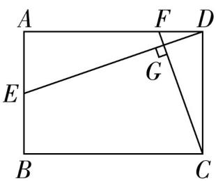

> [!success]- 必刷题
>
> > [!success] **【答案】** BC
>
> > [!note]- **【解析】**
> > 【证明】∵ $CD \perp AB, \therefore \angle CDA = \angle CDB = 90^{\circ}$ . ∵ $\angle ACB = 90^{\circ}, \therefore \angle ACD + \angle BCD = 90^{\circ}$ .
> >
> > 又∵ $\angle BCD + \angle B = 90^{\circ}, \therefore \angle ACD = \angle B, \therefore \triangle ACD \sim \triangle CBD.$
> >
> > (2)【证明】∵ $\angle ACB = \angle CDB = 90^{\circ}$ , $\angle B = \angle B$ , ∴ $\triangle ACB \sim \triangle CDB$ , ∴ $\frac{BC}{AB} = \frac{BD}{BC}$ , 即 $BC^{2} = BD \cdot AB$ .
> >
> > 刷有所得
> > 在任意直角三角形中过直角顶点向斜边作垂线,得到的两个小直角三角形都和原直角三角形相似.
> >
> > (3)【解】∵ $\triangle ACD \sim \triangle CBD, \therefore \frac{AD}{CD} = \frac{CD}{BD},$ ∴ $CD^{2}=AD\cdot DB.\because AD=3,BD=2,\therefore CD^{2}=6.$ ∵ CD>0, ∴ $CD=\sqrt{6}.$
> >
> > 大招解读 | 十字型
> > 如图, 在矩形 ABCD 中, 点 E, F 分别在边 AB, AD 上, $CF \perp ED$ 于 G.
> >
> > 
> >
> > 结论: $\triangle CDG\sim\triangle DEA\sim\triangle DFG\sim\triangle CFD.$
