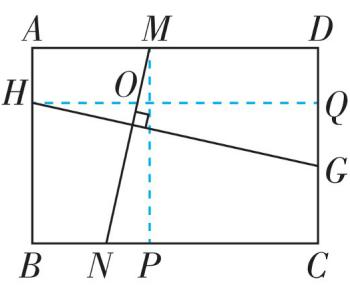
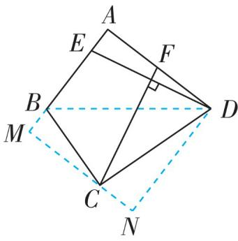

> [!success]- 必刷题
>
> > [!success] **【答案】** =
>
> > [!note]- **【解析】**
> > 【证明】过 M 作 $MP \perp BC$ 于 P，过 H 作 $HQ \perp CD$ 于 Q，交 MN 于 O，如图(1). 易得 $AD \parallel HQ \parallel BC, HQ = AD, MP = CD, \therefore \angle HON = \angle MNP. \because MN \perp GH, MP \perp BC, \therefore \angle QHG + \angle HON = 90^{\circ}, \angle MNP + \angle NMP = 90^{\circ}, \therefore \angle QHG = \angle NMP.$ 又 $\because \angle HQG = \angle MPN = 90^{\circ}, \therefore \triangle HQG \sim \triangle MPN, \therefore \frac{GH}{MN} = \frac{HQ}{MP} = \frac{AD}{CD}.$
> >
> > 
> > 图(1)
> >
> > 
> > 图(2)
> >
> > 【解】(3)由(1)可知, $\frac{DE}{CF}=\frac{AD}{CD}$ ,由(2)可知, $\frac{HG}{MN}=\frac{AD}{CD},\therefore\frac{DE}{CF}=\frac{GH}{MN}=\frac{7}{5}.$ (4) $\frac{DE}{CF}=\frac{25}{24}$ . 过点C作CM⊥AB交AB的延长线于M,过点D作DN⊥MC交MC的延长线于N,连接BD,如图(2),则易知四边形AMND是矩形, $\therefore AM=DN,AD=MN.\because AB=6,AD=8,\angle BAD=90^{\circ},\therefore BD=10.$ 又 $\because BC=6,CD=8,\therefore BC^{2}+CD^{2}=BD^{2},\therefore BC\perp CD,$ $\therefore\angle MCB+\angle NCD=90^{\circ}.$ 又 $\because\angle MCB+$ $\angle MBC=90^{\circ},\therefore\angle MBC=\angle DCN,\therefore\triangle CMB\sim$ $\triangle DNC,\therefore\frac{BM}{CN}=\frac{CM}{DN}=\frac{BC}{CD}=\frac{3}{4}.$ 设BM=x,则 $AM=6+x=DN,\therefore MC=\frac{3}{4}(6+x),CN=\frac{4}{3}x.$
> >
> > $\because CM + CN = AD = 8, \therefore \frac{3}{4} (6 + x) + \frac{4}{3} x = 8$ ，解得 $x = \frac{42}{25}, \therefore DN = \frac{192}{25}$ . 由（1）可知， $\frac{DE}{CF} = \frac{AD}{DN} = \frac{8}{\frac{192}{25}} = \frac{25}{24}$ .
> >
> > ## \* 5 相似三角形判定定理的证明
