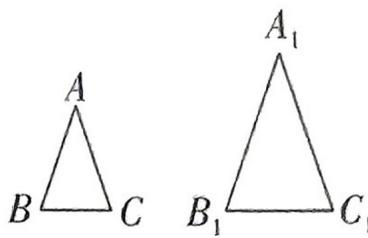

<!-- question-source:start -->
6 如图, 在等腰 $\triangle ABC$ 和等腰 $\triangle A_{1}B_{1}C_{1}$ 中, 底边的长 $BC = 4 \mathrm{~cm}, B_{1}C_{1} = 6 \mathrm{~cm}$ , 它们的周长分别为 $16 \mathrm{~cm}$ 和 $24 \mathrm{~cm}$ , 那么这两个等腰三角形的腰与底边是不是成比例线段? 说明理由.

<!-- question-source:end -->

![[Q00107942A1]]
