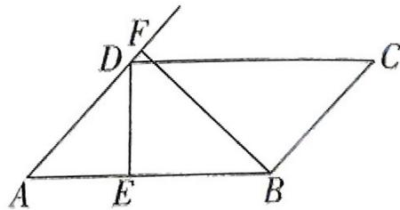

<!-- question-source:start -->
9 如图, 在 $\square ABCD$ 中, $DE \perp AB$ 于点 $E, BF \perp AD$ , 交 $AD$ 的延长线于点 $F$ . (1) $AB, BC, BF, DE$ 这四条线段能否成比例? 如果不能, 请说明理由; 如果能, 请写出比例式. (2) 若 $AB = 10, DE = 2.5, BF = 5$ , 求 $BC$ 的长.

2 刷易错 小心有坑\~
<!-- question-source:end -->

![[Q00107945A1]]
