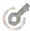
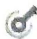

## 课时 1 成比例线段及比例的基本性质 刷基础

## 刷基础

## 知识点1 形状相同的图形

![[初中/课堂同步/教辅/必刷题/2026《初中必刷题》数学北师9上/04_第四章_图形的相似/课时_1_成比例线段及比例的基本性质/questions/Q00107937.md]]

## 知识点 2 两条线段的比

![[初中/课堂同步/教辅/必刷题/2026《初中必刷题》数学北师9上/04_第四章_图形的相似/课时_1_成比例线段及比例的基本性质/questions/Q00107938.md]]
![[初中/课堂同步/教辅/必刷题/2026《初中必刷题》数学北师9上/04_第四章_图形的相似/课时_1_成比例线段及比例的基本性质/questions/Q00107939.md]]
![[初中/课堂同步/教辅/必刷题/2026《初中必刷题》数学北师9上/04_第四章_图形的相似/课时_1_成比例线段及比例的基本性质/questions/Q00107940.md]]

## 知识点 3 成比例线段

![[初中/课堂同步/教辅/必刷题/2026《初中必刷题》数学北师9上/04_第四章_图形的相似/课时_1_成比例线段及比例的基本性质/questions/Q00107941.md]]
![[初中/课堂同步/教辅/必刷题/2026《初中必刷题》数学北师9上/04_第四章_图形的相似/课时_1_成比例线段及比例的基本性质/questions/Q00107942.md]]

## 知识点 4 比例的基本性质

![[初中/课堂同步/教辅/必刷题/2026《初中必刷题》数学北师9上/04_第四章_图形的相似/课时_1_成比例线段及比例的基本性质/questions/Q00107943.md]]
![[初中/课堂同步/教辅/必刷题/2026《初中必刷题》数学北师9上/04_第四章_图形的相似/课时_1_成比例线段及比例的基本性质/questions/Q00107944.md]]
![[初中/课堂同步/教辅/必刷题/2026《初中必刷题》数学北师9上/04_第四章_图形的相似/课时_1_成比例线段及比例的基本性质/questions/Q00107945.md]]

## 易错点 忽视线段成比例的顺序性而致错

![[初中/课堂同步/教辅/必刷题/2026《初中必刷题》数学北师9上/04_第四章_图形的相似/课时_1_成比例线段及比例的基本性质/questions/Q00107946.md]]
