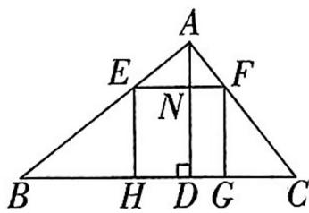

<!-- question-source:start -->
3 如图, 在 $\triangle ABC$ 中, $BC = 120$ , 高 $AD = 60$ , 正方形 $EFGH$ 一边在 $BC$ 上, 点 $E, F$ 分别在 $AB, AC$ 上, $AD$ 交 $EF$ 于点 $N$ , 则 $AN$ 的长为 ( )

A. 15 B. 20 C. 25 D. 30
<!-- question-source:end -->

![[Q00108065A1]]
