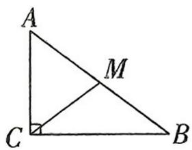
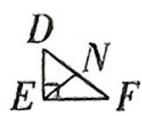

<!-- question-source:start -->
6 如图所示, Rt△ABC∽Rt△DFE, CM, EN 分别是斜边 AB, DF 上的中线, 已知 AC = 9 cm, CB = 12 cm, DE = 3 cm.

(1) 求 CM 和 EN 的长.

(2)你发现 $\frac{CM}{EN}$ 的值与相似比有什么关系？得

建议用时 25 分钟 答案 D61

到什么结论？

<!-- question-source:end -->

![[Q00108068A1]]
