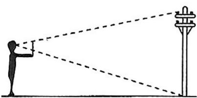
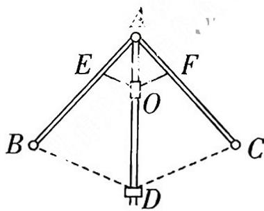

<!-- question-source:start -->
7[2025江西南昌校级质检]如图,小明用一把刻有厘米分划的小尺测量电线杆的高,他站在距电线杆水平距离约40米的地方,把手臂向前伸直与水平线平行,小尺竖直,看到尺上约12个分划(12厘米)恰好遮住电线杆,已知臂长约60厘米,则电线杆的高度近似为 ( )
A.6米 B.7米 C.8米 D.9米

(第7题图)
(第8题图)
<!-- question-source:end -->

![[Q00108069A1]]
