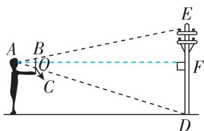

> [!success]- 必刷题
>
> > [!success] **【答案】** C
>
> > [!note]- **【解析】**
> > 如图, 过点 A 作 $AF \perp DE$ 交 BC 于 O, 交 DE 于 F.
> > ∵ BC // ED, ∴ AO ⊥
> >
> > 
> >
> > $BC, \triangle ABC \sim \triangle AED, \therefore \frac{BC}{DE} = \frac{AO}{AF}. \because BC = 0.12$ 米， $AO = 0.6$ 米， $AF = 40$ 米， $\therefore DE = \frac{BC \cdot AF}{AO} = \frac{0.12 \times 40}{0.6} = 8$ （米）， $\therefore$ 电线杆的高度近似为
