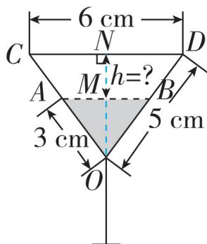

> [!success]- 必刷题
>
> > [!success] **【答案】** $\frac{8}{5}$
>
> > [!note]- **【解析】**
> > 如图, 过 $O$ 作
> > ON⊥CD于N, 交AB于M.
> > ∵ CD∥AB, ∴ OM⊥AB.
> > ∵ OC = OD, ∴ CN = $\frac{1}{2}$ CD =
> >
> > 
> >
> > $3\mathrm{cm},\therefore ON = \sqrt{OC^2 - CN^2} = \sqrt{5^2 - 3^2} = 4(\mathrm{cm}).$ $\because CD / / AB,\therefore$ 易得 $\triangle CDO\sim \triangle ABO,\therefore \frac{OA}{OC} =$ $\frac{OM}{ON},\therefore \frac{3}{5} = \frac{OM}{4},\therefore OM = \frac{12}{5}\mathrm{cm},\therefore h = 4 - \frac{12}{5} =$ $\frac{8}{5} (\mathrm{cm})$ ，故答案为 $\frac{8}{5}$
