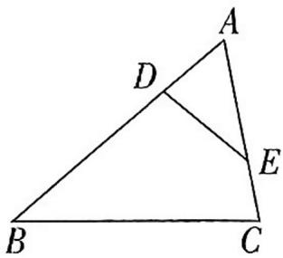
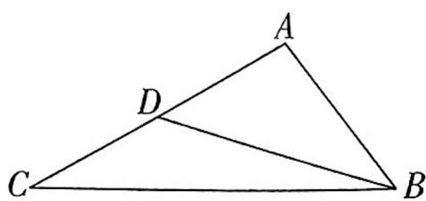

<!-- question-source:start -->
2[2025 北京通州区质检]如图, $\triangle ABC \sim \triangle AED$ , $\angle ADE = 80^{\circ}, \angle A = 60^{\circ}$ , 则 $\angle C =$ ( )
A. $40^{\circ}$ B. $60^{\circ}$ C. $80^{\circ}$ D. $100^{\circ}$

(第2题图)

(第3题图)
<!-- question-source:end -->

![[Q00107987A1]]
