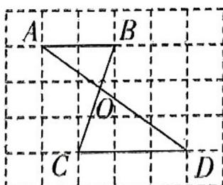

<!-- question-source:start -->
5 如图, 点 A, B, C, D 在网格中小正方形的顶点处, AD 与 BC 相交于点 O, 小正方形的边长为 1, 则 AO 的长等于 ( )
A. 2    B. $\frac{7}{3}$ C. $\frac{6\sqrt{2}}{5}$

A. 2 B. $\frac{7}{3}$ C. $\frac{6\sqrt{2}}{5}$ D. $\frac{9\sqrt{2}}{5}$
<!-- question-source:end -->

![[Q00107990A1]]
