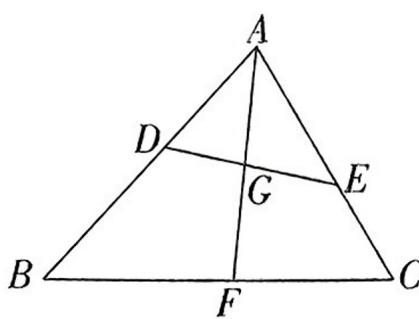

<!-- question-source:start -->
6 如图, 在 $\triangle ABC$ 中, $D, E$ 分别是 $AB, AC$ 上的点, $\angle AED = \angle ABC$ , $\angle BAC$ 的平分线 $AF$ 交 $DE$ 于

建议用时 25 分钟 答案 D50

点 G, 交 BC 于点 F.

(1)试写出图中所有的相似三角形,并说明理由.
(2)若 $\frac{AG}{GF}=\frac{3}{2}$ ，求 $\frac{DE}{BC}$ 的值.

2 刷易错 小心有坑\~
<!-- question-source:end -->

![[Q00107991A1]]
