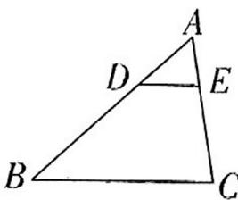

<!-- question-source:start -->
7 在 $\triangle ABC$ 中, $AB=6,BC=5,AC=4,D$ 是线段 $AB$ 上一点,且 $DB=4$ ,过点 $D$ 作 $DE$ 与线段 $AC$ 相交于点 $E$ ,使以 $A,D,E$ 为顶点的三角形与 $\triangle ABC$ 相似,求 $DE$ 的长.请根据下列两位同学的对话回答问题:

A:如图,过点 D 作 $DE \parallel BC$ , 交 AC 于点 E, 则 $\triangle ADE \sim \triangle ABC$ , $\therefore \frac{DE}{BC} = \frac{AD}{DB}, \therefore DE = \frac{AD}{DB} \cdot BC = \frac{AB - DB}{DB} \cdot BC = \frac{5}{2}.$

B: 这个解答中有两个错误, 其中一个是比例式写错了!

(1) 写出正确的比例式及后续解答；

(2)指出另一个错误,并给予正确解答.
<!-- question-source:end -->

![[Q00107992A1]]
