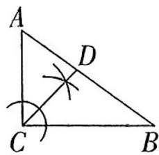
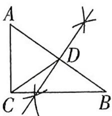
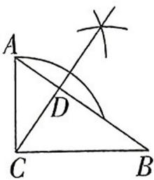
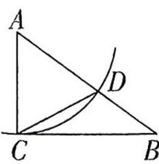

<!-- question-source:start -->
1 [2025 吉林长春质检, 中] 在 $\triangle ABC$ 中, $\angle ACB = 90^{\circ}$ , 用直尺和圆规在 $AB$ 上确定一点 $D$ , 使 $\triangle ACD \sim \triangle CBD$ , 根据作图痕迹判断, 正确的是 ( )

A

B

C

D
<!-- question-source:end -->

![[Q00107993A1]]
